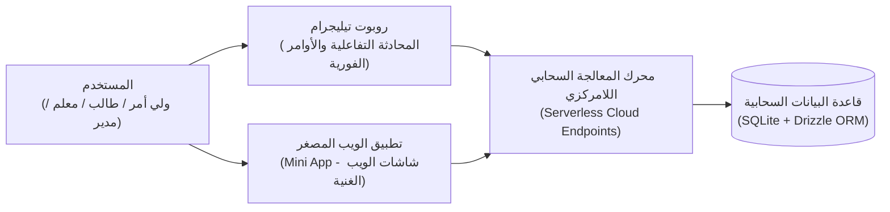
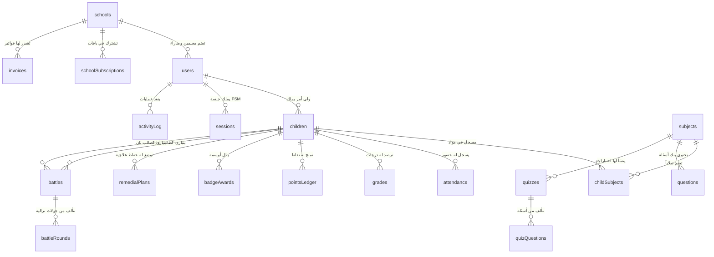
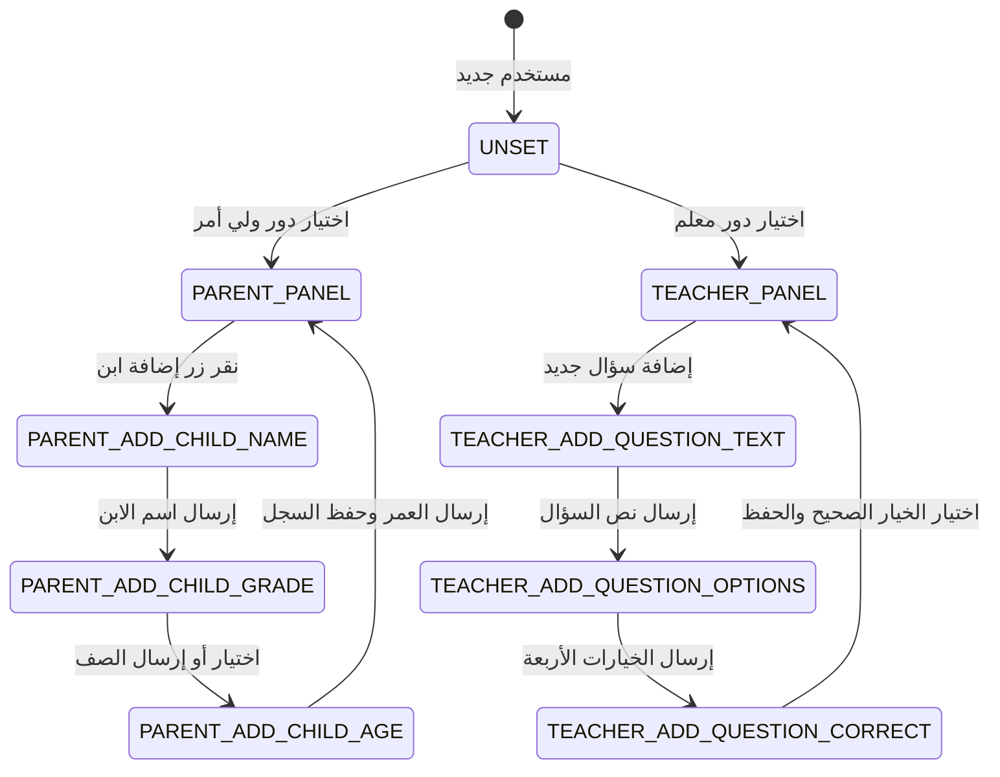

# 📖 سِفْرُ دَرْب: الكِتَابُ التَّشْرِيحِيُّ الكَامِلُ لِمَنْظُومَةِ التَّعْلِيمِ الذَّكِيِّ عَبْرَ تِيلِيجْرَام

> **«درب» (Darb)**: منظومة سحابية تعليمية رائدة تجمع بين واجهات روبوتات تيليجرام التفاعلية وتطبيقات الويب المصغرة (Telegram Mini Apps)، مصممة لخدمة منظومة التعليم المدرسي المتكاملة (الطلاب، أولياء الأمور، المعلمون، وإدارات المدارس).

---

## 🏛️ الفهرس العام لأبواب الكتاب

1. **[الباب الأول: الأسس المعمارية والهندسية لمنصة «درب»](#الباب-الأول-الأسس-المعمارية-والهندسية-لمنصة-درب)**
   - الفصل الأول: الرؤية والفلسفة التصميمية (لماذا تيليجرام؟ ولماذا البنية اللامركزية Serverless؟)
   - الفصل الثاني: قيود بيئة تيليجرام الصارمة وكيف تم تطويعها هندسياً
   - الفصل الثالث: مبدأ "وحدة مصدر الحقيقة" (Single Source of Truth) وخلو المنظومة من التوليد العشوائي

2. **[الباب الثاني: التشريح الهيكلي لقاعدة البيانات (39 جدولاً في schema.js)](#الباب-الثاني-التشريح-الهيكلي-لقاعدة-البيانات)**
   - الفصل الأول: خريطة الكيانات والعلاقات الكلية (Entity-Relationship Diagram)
   - الفصل الثاني: منظومة المستخدمين والصلاحيات والجلسات والتدقيق
   - الفصل الثالث: منظومة الطلاب والارتباطات الأكاديمية بالأسر
   - الفصل الرابع: سجلات الانضباط، التحضير الذكي بالباركود، والتقييمات
   - الفصل الخامس: منظومة التلعيب المحاسبية، حلبة النزالات، والأوسمة
   - الفصل السادس: بنوك الأسئلة، الاختبارات الموقوتة، والخطط العلاجية
   - الفصل السابع: البنية المؤسسية متعددة المستأجرين (SaaS) والاشتراكات
   - الفصل الثامن: الحوكمة والشروط القانونية والتخصيصات والجدول الأسبوعي

3. **[الباب الثالث: المحرك التفاعلي لتيليجرام وآلة الحالة المنتهية (FSM & Handlers)](#الباب-الثالث-المحرك-التفاعلي-لتيليجرام-وآلة-الحالة-المنتهية)**
   - الفصل الأول: ميكانيكا آلة الحالات (28 حالة في `STATE`) ودورة حياة الجلسة
   - الفصل الثاني: التشريح التفصيلي لمعالج الرسائل والأوامر (`handlers/message.js`)
   - الفصل الثالث: التشريح التفصيلي لمعالج ضغطات الأزرار الشفافة (`handlers/callback_query.js`)

4. **[الباب الرابع: تشريح محركات المنطق البرمجي والمكتبات المشتركة (`tgcloud/lib/`)](#الباب-الرابع-تشريح-محركات-المنطق-البرمجي-والمكتبات-المشتركة)**
   - الفصل الأول: محرك التقارير الأسبوعية التراكمية وصياغتها (`reports.js`)
   - الفصل الثاني: محرك الجدولة الزمنية والموجز الصباحي والتذكيرات (`scheduler.js`, `reminders.js`)
   - الفصل الثالث: محرك التلعيب المحاسبي ورتب الشرف والأوسمة (`gamification.js`)
   - الفصل الرابع: محرك التقييم التكيفي والتدريب وسد الفجوات (`placement.js`, `training.js`, `trainingHistory.js`)
   - الفصل الخامس: واجهة المستخدم وقوالب المحادثة ولوحات المفاتيح (`ui.js`, `panel.js`)
   - الفصل السادس: طبقة التخزين والاستعلامات الـ 178 الشاملة (`store.js`)
   - الفصل السابع: محركات الإشعارات الفورية، التصدير، الإحالة، والتحقق (`notify.js`, `export.js`, `referral.js`, `validate.js`, `start.js`, `config.js`)

5. **[الباب الخامس: تشريح واجهات الـ API السحابية (52 نقطة نهاية في `tgcloud/endpoints/`)](#الباب-الخامس-تشريح-واجهات-الـ-api-السحابية)**
   - الفصل الأول: معمارية بروتوكول الأمان وتكامل `ctx.initData` وحماية المستأجر
   - الفصل الثاني: نقاط نهاية النزالات التنافسية وبنوك الأسئلة والاختبارات
   - الفصل الثالث: نقاط نهاية لوحات التحكم والتقارير الشاملة
   - الفصل الرابع: نقاط نهاية التحضير الذكي، تصحيح الواجبات، والملاحظات التربوية
   - الفصل الخامس: نقاط نهاية إدارة المدارس والمستأجرين المتعددين SaaS
   - الفصل السادس: نقاط نهاية الحوكمة والتعاميم والجدولة السحابية Cron

6. **[الباب السادس: تشريح تطبيقات الويب المصغرة وتجربة المستخدم (`dist/`)](#الباب-السادس-تشريح-تطبيقات-الويب-المصغرة-وتجربة-المستخدم)**
   - الفصل الأول: معمارية تطبيقات الصفحة الواحدة (SPA) وتكامل Telegram WebApp SDK
   - الفصل الثاني: بوابة الطالب وولي الأمر (`index.html`) والرسوم البيانية الصافية (Pure SVG)
   - الفصل الثالث: بوابة المعلم الأكاديمية والتحضير الجماعي (`teacher.html`)
   - الفصل الرابع: بوابة الإدارة المركزية العليا والحوكمة (`admin.html`)
   - الفصل الخامس: بوابة إدارة المدرسة المستقلة وباقات الاشتراك (`school.html`)
   - الفصل السادس: التوافق الطباعي والوثائق والسياسات القانونية الثلاث

7. **[الباب السابع: هندسة الإطلاق والنشر السحابي والتشغيل والحوكمة](#الباب-السابع-هندسة-الإطلاق-والنشر-السحابي-والتشغيل-والحوكمة)**
   - الفصل الأول: خطوات التهيئة والإطلاق وإعداد متغيرات البيئة
   - الفصل الثاني: إدارة المهام المجدولة السحابية والأمان المشفر
   - الفصل الثالث: استراتيجية النسخ الاحتياطي وحماية البيانات
   - الفصل الرابع: منظومة الفحص الآلي المستمر وفلسفة الاختبارات البرمجية

---

# الباب الأول: الأسس المعمارية والهندسية لمنصة «درب»

---

## الفصل الأول: الرؤية والفلسفة التصميمية

### 1.1 لماذا تيليجرام كبيئة تشغيل أساسية؟
في معظم النظم التعليمية التقليدية، يعاني أولياء الأمور والطلاب من عائق "تحميل تطبيق جديد" وتثبيته وتسجيل الدخول وتفعيل الإشعارات، مما يؤدي إلى نسب تسرب رقمي تتجاوز 70% في التفاعل والمتابعة المنزلية.
جاء اختيار منصة **تيليجرام (Telegram)** لعدة اعتبارات استراتيجية:
1. **الانتشار اللحظي دون عوائق تثبيت**: يتوفر تيليجرام على كافة الأجهزة (Android, iOS, Windows, macOS, Web)، مما يجعل التطبيق متاحاً فورياً لأي أسرة دون الحاجة لزيارة متاجر التطبيقات.
2. **قنوات الاتصال المزدوجة**: يجمع تيليجرام بين كفاءة الإشعارات اللحظية الفورية عالية الموثوقية (Push Notifications) عبر محادثات البوت، وبين الثراء البصري التفاعلي لتطبيقات الويب المصغرة (**Telegram Mini Apps**) التي تُفتح داخل المحادثة كصفحة ويب متكاملة فائقة السرعة.
3. **التوثيق الآمن الأصيل**: توفر واجهة برمجة تيليجرام آلية مصادقة مشفرة بتوقيع رقمي (`initData`) تعتمد على خوارزمية HMAC-SHA256، مما يلغي الحاجة تماماً لكلمات المرور التقليدية ومشاكل نسيانها.



---

### 1.2 لماذا البنية السحابية اللامركزية (Serverless)؟
تم بناء منصة «درب» على بنية سحابية موجهة بالكامل بنظام الدوال السحابية اللامركزية (**Serverless Functions / Cloud Endpoints**):
* **انعدام كلفة الخوادم الخاملة**: لا توجد خوادم افتراضية تعمل على مدار الساعة دون فائدة؛ الدوال تُستدعى وتنفذ خلال أجزاء من الثانية ثم تتوقف.
* **التوسع التلقائي الفوري (Auto-scaling)**: عند إرسال تعميم مدرسي لآلاف الطلاب أو عند بدء اختبار موقوت جماعي، تتوسع المنظومة أوتوماتيكياً لاستيعاب آلاف الطلبات المتزامنة دون انهيار في موارد المعالجة.
* **العزل التام للأخطاء (Fault Isolation)**: كل نقطة نهاية سحابية (Endpoint) تعمل في سياق تنفيذي مستقل؛ فلو حدث خطأ غير متوقع في تصدير تقرير، فلن يؤثر ذلك مطلقاً على تسجيل الحضور أو خوض النزالات.

---

## الفصل الثاني: قيود بيئة تيليجرام الصارمة وكيف تم تطويعها هندسياً

يفرض تيليجرام قيوداً برمجية صارمة على واجهات الروبوتات لحماية مستخدميه وشبكاته من الإغراق، وقد نجح مهندسو المنصة في تطويع هذه القيود عبر حلول برمجية مبتكرة:

### 2.1 قيد الـ 64 بايت لبيانات الأزرار الشفافة (`callback_data`)
* **التحدي**: يرفض تيليجرام أي زر شفاف يحتوي في حقله `callback_data` على أكثر من 64 بايت. هذا يعني استحالة إرسال نصوص طويلة أو كائنات JSON في الزر.
* **الحل الهندسي المبتكر**: اعتماد بروتوكول البادئات المقتضبة فائقة الكثافة (Micro-Prefix Routing):
  * `p:add` ← ولي أمر: إضافة ابن (5 بايت فقط).
  * `c:12:sub` ← بطاقة الابن رقم 12: استعراض المواد (10 بايت).
  * `qnew:4:A` ← بنك الأسئلة: تحديد الجواب الصحيح A للسؤال في المادة 4 (10 بايت).
  * `t:b:7` ← لوحة المعلم: تحضير جماعي للمادة 7 (7 بايت).
  يتم تفكيك السلسلة النصية عبر دالة الفصل `data.split(':')` لاستخراج المعاملات بكفاءة قصوى، مما وفر أكثر من 80% من سعة البايت المسموحة.

### 2.2 قيد الحد الأقصى لطول الرسالة (4096 حرفاً)
* **التحدي**: الرسائل النصية المجمعة كالتقارير الأسبوعية للطلاب المتفوقين أو كشوف الدرجات الشاملة قد تتجاوز حد 4096 حرفاً، مما يؤدي لرفض تيليجرام إرسالها ورمي استثناء `MESSAGE_TOO_LONG`.
* **الحل الهندسي**:
  1. في التقارير الأسبوعية (`tgcloud/lib/reports.js`): حصر عدد الأخطاء بآخر 5 موضوعات متعثرة، واقتطاع نصوص الملاحظات، وتوجيه ولي الأمر بفتح تطبيق الويب المصغر (Mini App) للاستعراض الشامل.
  2. في كشوف المعلمين الشاملة: تم تحويل البيانات الضخمة إلى ملفات مجدولة بصيغة CSV ترسل كملف مرفق قابل للتحميل عبر دالة `exportTeacherReport.js`، مما ألغى العائق نهائياً.

### 2.3 منع تكرار النقر وتأخير الشبكة (Idempotency & Debouncing)
* **التحدي**: عند ضعف اتصال الإنترنت، قد ينقر ولي الأمر زر "تسجيل الحضور" أو "اعتماد النتيجة" عدة مرات متتالية، مما قد يسبب تكرار العمليات أو ازدواجية الخصم والإضافة في رصيد النقاط.
* **الحل الهندسي**:
  1. استدعاء فوري لدالة `api.answerCallbackQuery(cq.id)` لإيقاف علامة التحميل اللولبية في شاشة المستخدم.
  2. التعديل الموضعي للرسالة (`api.editMessageText`) لاستبدال الأزرار برسالة "جارٍ المعالجة..." أو حذف لوحة المفاتيح التفاعلية فور النقر الأول.
  3. استخدام معالجة التعارض في قاعدة البيانات (`ON CONFLICT DO UPDATE` و قيود المفاتيح الفريدة المركبة `uniqueIndex`) لمنع إنشاء سجلات مكررة في نفس اليوم والحصة.

---

## الفصل الثالث: مبدأ "وحدة مصدر الحقيقة" (Single Source of Truth) وخلو المنظومة من التوليد العشوائي

### 3.1 مبدأ وحدة مصدر الحقيقة في الحسابات الأكاديمية
في النظم التعليمية، يعد التناقض في البيانات بين ما يراه المعلم وما يراه ولي الأمر كارثة ثقة. لذلك تم تطبيق هذا المبدأ بصرامة حديدية:
* لا توجد أي جداول وسيطة لحساب معدلات الحضور أو الدرجات الشهرية بشكل منفصل.
* تُستخرج جميع الإحصائيات (نسبة الحضور، متوسط الدرجات، الأخطاء الشائعة، نقاط التلعيب) لحظياً ومباشرة من جداول الحقيقة التشغيلية:
  * نسبة الحضور تُحسب مباشرة من جدول `attendance`.
  * متوسط الدرجات يُحسب مباشرة من جدول `grades`.
  * رصيد النقاط يُحسب تجميعياً من دفتر الأستاذ `points_ledger`.
  * التقرير الأسبوعي في البوت يطابق بالمليمتر ما يعرضه تطبيق الويب المصغر في `index.html`.

### 3.2 خلو المنظومة التام من الذكاء الاصطناعي التوليدي والهلوسة الأكاديمية
اتخذت إدارة المشروع قراراً استراتيجياً قاطعاً بعدم استخدام أي نماذج ذكاء اصطناعي توليدي تجارية (مثل ChatGPT أو Gemini) في توليد الأسئلة أو تصحيح الاختبارات أو الرد على استفسارات الطلاب وأولياء الأمور، وذلك للأسباب الحتمية التالية:
1. **الوقاية من الهلوسة العلمية (Zero Hallucination)**: الذكاء الاصطناعي التوليدي قد يخطئ في تصحيح مسألة رياضية أو ينسب قاعدة نحوية لغير بابها، وهو ما لا يُقبل في المنظومات المدرسية الحساسة.
2. **الاعتماد البشري المعتمد**: بنك الأسئلة والمواد الإثرائية تُبنى وتُراجع وتُعتمد بشرياً من قبل معلمي المدرسة والمشرفين الأكاديميين المعتمدين حصراً وفق مسار تدقيق صارم (`pending` ← `approved`).
3. **الخوارزميات التكيفية الحتمية (Deterministic Adaptive Algorithms)**: يعتمد تحديد المستوى والتدريب العلاجي على خوارزميات رياضية إحصائية واضحة وثابتة (Matrix-based scoring & error aggregation)، مما يجعل قرارات التقييم عادلة وشفافة وقابلة للتدقيق في أي لحظة.

---

# الباب الثاني: التشريح الهيكلي لقاعدة البيانات (39 جدولاً في schema.js)

---

## الفصل الأول: خريطة الكيانات والعلاقات الكلية

تعتمد منصة «درب» على محرك قواعد بيانات علائقية متقدم قائم على معايير SQL المدارة عبر **Drizzle ORM**، مما يوفر أماناً نوعياً تاماً (Type-Safety) وسرعة استعلامات فائقة بالمللي ثانية، مع عزل أمني دقيق بين المستأجرين والأسر.



---

## الفصل الثاني: منظومة المستخدمين والصلاحيات والجلسات والتدقيق

### 1. جدول المستخدمين (`users`)
المستودع الرئيسي لكافة الهويات البشرية المتفاعلة مع المنظومة.
* `id` (`integer`, Primary Key, Auto-increment): المعرّف الرقمي الداخلي الثابت.
* `tgId` (`integer`, Unique, Not Null): معرّف تيليجرام الفريد للمستخدم، وهو الرابط الجوهري لتأكيد الهوية.
* `role` (`text`, Not Null, Default: `'unset'`): الدور الوظيفي للمستخدم (`parent`, `student`, `teacher`, `admin`, `school_admin`, `unset`).
* `fullName` (`text`): الاسم الثلاثي أو الرباعي المعتمد.
* `username` (`text`): المعرّف المعرف بـ @ في تيليجرام لتسهيل التواصل والبحث.
* `schoolId` (`integer`, Foreign Key → `schools.id`): معرّف المدرسة التابع لها المعلم أو المدير.
* `isActive` (`integer` [boolean], Default: `true`): حالة تفعيل الحساب لإمكانية التعليق الإداري الفوري.
* `createdAt` و `updatedAt` (`integer` [timestamp]): الطوابع الزمنية الدقيقة لإنشاء وتعديل السجل.

### 2. جدول الجلسات التفاعلية (`sessions`)
محرك ذاكرة الحالة (FSM Memory) لتتبع موقع المستخدم في خطوات المحادثة.
* `tgId` (`integer`, Primary Key, Unique): معرّف تيليجرام للمستخدم.
* `state` (`text`, Not Null): كود الحالة النشطة الحالية من جدول الحالات الـ 28.
* `payload` (`text` [JSON]): حمولة البيانات المؤقتة التي يدخلها المستخدم خطوة بخطوة قبل الحفظ النهائي (مثل بيانات إضافة ابن أو بنك أسئلة).
* `updatedAt` (`integer` [timestamp]): طابع وقت آخر تفاعل لمراقبة مهلة انتهاء الجلسة.

### 3. جدول سجل التدقيق والعمليات الرقابية (`activity_log`)
الصندوق الأسود للمنصة لتوثيق كل حركة إدارية أو مالية أو أكاديمية لمنع التلاعب وتتبع الأخطاء.
* `id` (`integer`, Primary Key): رقم العملية التسلسلي.
* `actorUserId` (`integer`, Foreign Key → `users.id`): المستخدم الفاعل الذي نفذ العملية.
* `action` (`text`, Not Null): نوع الإجراء (مثل `role_selected`, `attendance_recorded`, `grade_added`).
* `targetType` و `targetId`: الكيان المستهدف بنوع ومعرّف (مثل `child`, `question`, `school`).
* `meta` (`text` [JSON]): التفاصيل الدقيقة للتعديل والقيم السابقة والجديدة.
* `createdAt` (`integer` [timestamp]): وقت وقوع الحدث بدقة المللي ثانية.

---

## الفصل الثالث: منظومة الطلاب والارتباطات الأكاديمية بالأسر

### 4. جدول الأبناء والطلاب (`children`)
* `id` (`integer`, Primary Key): معرّف الطالب الموحد في المنظومة.
* `parentUserId` (`integer`, Foreign Key → `users.id`): ولي الأمر الشرعي المسؤول عن الطالب.
* `studentUserId` (`integer`, Foreign Key → `users.id`, Nullable): حساب تيليجرام المستقل الخاص بالطالب بعد ربطه.
* `fullName` (`text`, Not Null): الاسم الكامل للطالب.
* `grade` (`text`): الصف الدراسي المقيد به (مثل "الصف الرابع الابتدائي").
* `age` (`integer`): عمر الطالب بالسنوات.
* `verifyCode` (`text`, Unique): كود سري مشفر يتكون من 6 إلى 8 أحرف وأرقام يُولّد لربط حساب تيليجرام الخاص بالطالب بحساب والده.
* `status` (`text`, Default: `'pending'`): حالة قيد الطالب (`pending` قيد التأكيد، `active` نشط، `paused` موقوف مؤقتاً، `deleted` محذوف ناعماً).

### 5. جدول المقررات والمناهج الدراسية (`subjects`)
* `id` (`integer`, Primary Key): معرّف المادة.
* `schoolId` (`integer`, Foreign Key → `schools.id`): المدرسة المالكة للمقرر.
* `title` (`text`, Not Null): عنوان المقرر (مثل: "الرياضيات"، "لغتي الجميلة").
* `kind` (`text`, Default: `'school'`): نوع المقرر (`school` منهجي، `course` إثرائي، `extracurricular` لا صفي).
* `description` (`text`): توصيف المنهج وأهدافه التعليمية.
* `teacherUserId` (`integer`, Foreign Key → `users.id`): المعلم المعتمد المسؤول عن تدريس المقرر.
* `approvalStatus` (`text`, Default: `'approved'`): مسار الاعتماد الإداري للمادة (`pending`, `approved`, `rejected`).
* `isActive` (`integer` [boolean]): تفعيل أو أرشفة المقرر.

### 6. جدول ربط الأبناء بالمواد (`child_subjects`)
جدول وسيط علائقي متقدم (Many-to-Many Bridge Table) يربط كل طالب بمواده المعتمدة مع فهرس فريد مركب `uniqueIndex('child_subject_idx', [childId, subjectId])` لمنع ازدواجية التسجيل.

---

## الفصل الرابع: سجلات الانضباط، التحضير الذكي بالباركود، والتقييمات

### 7. جدول الحضور والغياب والانضباط (`attendance`)
* `id` (`integer`, Primary Key): رقم السجل.
* `childId` (`integer`, Foreign Key → `children.id`): معرّف الطالب.
* `subjectId` (`integer`, Foreign Key → `subjects.id`): المادة الدراسية للحصة.
* `sessionDate` (`text`, Not Null): تاريخ الحصة بصيغة ISO القياسية (`YYYY-MM-DD`).
* `status` (`text`, Not Null): حالة الانضباط الحتمية:
  * `present` (حاضر)
  * `late` (متأخر)
  * `absent` (غائب)
  * `excused` (غياب بعذر مقبول)
* `note` (`text`): ملاحظات المعلم التوضيحية (مثل: "تأخر 15 دقيقة بعذر صحي").
* `recordedByUserId` (`integer`, Foreign Key → `users.id`): هوية المعلم أو المشرف الراصد.
* قيد فريد مركب: `UNIQUE(childId, subjectId, sessionDate)` لضمان عدم إمكانية رصد حضور الطالب مرتين لنفس المادة في نفس اليوم.

### 8. جدول رموز التحضير الذكي المؤقتة (`qr_attendance_tokens`)
* `id` (`integer`, Primary Key): معرّف الرمز.
* `subjectId` (`integer`, Foreign Key → `subjects.id`): الحصة المستهدفة.
* `token` (`text`, Unique, Not Null): الرمز المشفر المولد عشوائياً والمعروض على شاشة الفصل.
* `sessionDate` (`text`, Not Null): تاريخ الجلسة.
* `expiresAt` (`integer` [timestamp], Not Null): وقت إبطال الرمز التلقائي (مضبوط بـ 10 دقائق كحد أقصى لمنع التداول خارج الصف).

### 9. جدول التقييمات والدرجات المدرسية (`grades`)
* `id` (`integer`, Primary Key): معرّف التقييم.
* `childId` (`integer`, Foreign Key → `children.id`): الطالب المرصود له الدرجة.
* `subjectId` (`integer`, Foreign Key → `subjects.id`): المادة.
* `title` (`text`, Not Null): عنوان الاختبار أو الواجب (مثل: "اختبار منتصف الفصل الأول").
* `score` (`real`, Not Null): الدرجة المحققة فعلياً.
* `maxScore` (`real`, Not Null, Default: `100`): الدرجة العظمى الممكنة للتقييم.
* `assessedAt` (`text`): تاريخ الرصد الفعلي.
* `teacherUserId` (`integer`, Foreign Key → `users.id`): المعلم الراصد.

---

## الفصل الخامس: منظومة التلعيب المحاسبية، حلبة النزالات، والأوسمة

### 10. دفتر أستاذ النقاط التراكمي (`points_ledger`)
تعتمد المنصة مبدأ محاسبياً مالياً صارماً في التعامل مع نقاط التحفيز (Double-Entry Ledger Principle):
* لا يوجد عمود واحد اسمه "رصيد النقاط" يتم تعديله عشوائياً في جدول الطلاب!
* كل نقطة يكتسبها الطالب أو يخسرها تُقيد كسطر مستقل غير قابل للحذف في هذا الدفتر:
  * `childId` (`integer`, Foreign Key → `children.id`): الطالب المستفيد.
  * `points` (`integer`, Not Null): قيمة الحركة (+10 للحضور المبكر، +15 لحل الواجب، +25 للفوز بالنزال).
  * `reason` (`text`, Not Null): السبب المحاسبي الموثق للعملية.
  * `refType` و `refId`: المرجع التشغيلي المباشر (مثل `attendance:45`, `quiz_attempt:102`).
  * `createdAt` (`integer` [timestamp]): الطابع الزمني للعملية.
* رصيد الطالب الحالي هو حاصل الجمع الرياضي التراكمي `SUM(points)` لجميع قيود دفتر الأستاذ.

### 11. جدول تعريفات الأوسمة (`badge_definitions`) وجدول منح الأوسمة (`badge_awards`)
* `badge_definitions`: يحدد الأوسمة الوطنية والأكاديمية المعيارية (`code`, `title`, `icon`, `description`, `requiredPoints`).
* `badge_awards`: يوثق لحظة حصول الطالب على وسام محدد مع منع التكرار بواسطة قيد فريد مركب `UNIQUE(childId, badgeCode)`.

### 12. حلبة النزالات والتحديات الثنائية (`battles` & `battle_rounds`)
* `battles`: يدير المواجهات التنافسية الثنائية بين الطلاب في مادة محددة:
  * `child1Id` و `child2Id`: المتنافسان.
  * `status`: حالة النزال (`pending` بانتظار القبول، `active` جارٍ التنافس، `completed` مكتمل، `declined` مرفوض).
  * `score1` و `score2`: درجات كل متنافس.
  * `winnerChildId`: الفائز المستحق للنقاط التنافسية.
* `battle_rounds`: الأسئلة الـ 5 المخصصة للنزال وإجابة كل طالب والوقت المستغرق بالمللي ثانية لكسر التعادل عند تساوي الدرجات.

---

## الفصل السادس: بنوك الأسئلة، الاختبارات الموقوتة، والخطط العلاجية

### 13. بنك الأسئلة المعتمد (`questions`)
* `id` (`integer`, Primary Key): معرّف السؤال.
* `subjectId` (`integer`, Foreign Key → `subjects.id`): المادة التابع لها.
* `text` (`text`, Not Null): نص المسألة أو السؤال التعليمي.
* `optionA`, `optionB`, `optionC`, `optionD` (`text`, Not Null): خيارات الإجابة الأربعة.
* `correctOption` (`text`, Not Null): الخيار الصحيح الصريح (`A`, `B`, `C`, `D`).
* `difficulty` (`text`, Not Null): مستوى الصعوبة التكيفي (`easy`, `medium`, `hard`).
* `topic` (`text`, Not Null): المفهوم أو المهارة الدقيقة (مثل: "جمع الكسور"، "الفاعل والمفعول به").
* `approvalStatus` (`text`, Default: `'approved'`): حالة الاعتماد من المشرف.

### 14. جدول الاختبارات الإلكترونية الموقوتة (`quizzes`) وجدول أسئلة الاختبار (`quiz_questions`)
* `quizzes`: يحدد مواصفات الاختبار (`durationMinutes`, `passingScore`, `maxScore`, `isActive`).
* `quiz_questions`: يربط أسئلة بنك الأسئلة بالاختبار ويرتبها تسلسلياً بواسطة عمود `orderIndex`.

### 15. جدول الخطط العلاجية وسد الفجوات (`remedial_plans`)
* عندما يخفق الطالب في مهارة أو مفهوم محدد بنسبة تقل عن 60% في أي اختبار، يُولّد له هذا الجدول خطة دعم علاجية ذكية:
  * `childId`: الطالب المتعثر.
  * `subjectId`: المادة.
  * `topic`: المفهوم المستهدف بالعلاج المكثف.
  * `initialScorePct`: النسبة التشخيصية الأولية.
  * `masteryScorePct`: النسبة المحققة بعد إكمال التدريبات العلاجية.
  * `status`: حالة الخطة (`pending` قيد الممارسة، `mastered` تم إتقان المهارة بنجاح).

---

## الفصل السابع: البنية المؤسسية متعددة المستأجرين (SaaS) والاشتراكات

### 16. جدول المدارس والصروح التعليمية (`schools`)
* `id` (`integer`, Primary Key): معرّف المنشأة.
* `name` (`text`, Not Null): الاسم الرسمي للصرح التعليمي.
* `code` (`text`, Unique): كود مدرسي فريد لانضمام المعلمين والطلاب.
* `principalUserId` (`integer`, Foreign Key → `users.id`): مدير المدرسة المعتمد.
* `plan` (`text`, Default: `'starter'`): باقة الاشتراك (`starter`, `pro`, `enterprise`).
* `maxStudents` و `maxTeachers`: السعة الاستيعابية المسموحة بموجب الباقة لمنع التجاوز.

### 17. جدول الاشتراكات المؤسسية والفواتير (`school_subscriptions` & `invoices`)
* يدير دورات الفوترة (شهرية / سنوية)، وتواريخ بدء وانتهاء الترخيص، وسجلات السداد المصرفي والفواتير الرسمية.

---

## الفصل الثامن: الحوكمة والشروط القانونية والتخصيصات والجدول الأسبوعي

### 18. جدول إصدارات الشروط القانونية والموافقات (`terms_versions` & `terms_consents`)
* يوثق أي تعديل في سياسة الخصوصية برقم إصدار تصاعدي (`version`: مثل "1.0", "1.1").
* عند ترقية الإصدار، يُلزم النظام كافة المستخدمين في محادثاتهم بإعادة الإقرار والموافقة قبل استئناف استخدام البوت لحماية المنصة قانونياً.

### 19. جدول التخصيصات والهوية البصرية (`customizations`)
* يخزن متغيرات النظام المخصصة للمدارس (الألوان، الشعار، نصوص الترحيب) بنظام المفتاح والقيمة (`key`, `value`, `category`).

### 20. جدول الحصص الأسبوعي (`timetable`)
* ينظم مواعيد الحصص المدرسية لكل مادة: اليوم من الأسبوع (`dayOfWeek`: 0 للأحد حتى 6 للسبت)، وتوقيت البدء والانتهاء، والموقع أو القاعة الدراسية.

---

# الباب الثالث: المحرك التفاعلي لتيليجرام وآلة الحالة المنتهية (FSM & Handlers)

---

## الفصل الأول: ميكانيكا آلة الحالات (28 حالة في `STATE`) ودورة حياة الجلسة

### 1.1 معمارية آلة الحالة المنتهية (Finite State Machine - FSM)
تعتمد الروبوتات المحادثية المتطورة على مفهوم **آلة الحالة المنتهية** لفرز مدخلات المستخدم وفق السياق الذي يقف فيه. بدون هذه الآلة، لو أرسل ولي الأمر اسماً مثل "أحمد"، فلن يعلم النظام هل يقصد إضافة ابن جديد؟ أم تعديل اسم ابن قائم؟ أم يبحث عن طالب في المدرسة؟
تُخزن الحالة النشطة للمستخدم في جدول `sessions` برقم تيليجرام الخاص به (`tgId`).



---

### 1.2 الدليل المعجمي للحالات الـ 28 المعتمدة في النظام

| كود الحالة (`STATE`) | المسمى الوظيفي | الغرض ومسار التحول |
| :--- | :--- | :--- |
| `UNSET` | غير محدد | الحالة المبدئية عند أول دخول للمستخدم قبل اختيار دوره. |
| `PARENT_ADD_CHILD_NAME` | إدخال اسم الابن | انتظار استقبال الاسم الثلاثي للابن المراد تسجيله. |
| `PARENT_ADD_CHILD_GRADE` | إدخال الصف الدراسي | انتظار إدخال المرحلة أو الصف الدراسي للابن. |
| `PARENT_ADD_CHILD_AGE` | إدخال عمر الابن | انتظار إدخال العمر العددي للابن واكتمال التسجيل. |
| `PARENT_EDIT_CHILD_NAME` | تعديل اسم الابن | استقبال الاسم الجديد للابن وتحديث سجله في قاعدة البيانات. |
| `PARENT_LINK_STUDENT` | ربط حساب الطالب | استقبال كود التحقق السري لربط حساب تيليجرام الخاص بالطالب. |
| `PARENT_SET_REMINDER_TITLE` | عنوان التذكير | انتظار إدخال موضوع جلسة المذاكرة أو الاختبار القادم. |
| `PARENT_SET_REMINDER_DUE` | موعد التذكير | استقبال تاريخ ووقت التذكير وتدقيقه بصيغة قياسية. |
| `TEACHER_ADD_SUBJECT_TITLE` | عنوان المادة الجديدة | استقبال اسم المقرر الدراسي المقترح من المعلم. |
| `TEACHER_ADD_SUBJECT_DESC` | وصف المادة | استقبال التوصيف الأكاديمي للمقرر الجديد. |
| `TEACHER_RECORD_ATTENDANCE` | رصد الحضور | استقبال حالة الطالب (حاضر / غائب / متأخر) في الحصة الفردية. |
| `TEACHER_ADD_GRADE_SCORE` | رصد درجة التقييم | استقبال الدرجة الرقمية المكتسبة للواجب أو الاختبار. |
| `TEACHER_ADD_GRADE_TITLE` | عنوان التقييم | استقبال مسمى الاختبار أو الواجب المرصود. |
| `TEACHER_ADD_QUESTION_TEXT` | نص السؤال | استقبال نص مسألة الاختيار من متعدد في بنك الأسئلة. |
| `TEACHER_ADD_QUESTION_A` | الخيار الأول (أ) | استقبال نص الخيار الأول للسؤال. |
| `TEACHER_ADD_QUESTION_B` | الخيار الثاني (ب) | استقبال نص الخيار الثاني للسؤال. |
| `TEACHER_ADD_QUESTION_C` | الخيار الثالث (ج) | استقبال نص الخيار الثالث للسؤال. |
| `TEACHER_ADD_QUESTION_D` | الخيار الرابع (د) | استقبال نص الخيار الرابع للسؤال. |
| `TEACHER_ADD_QUESTION_CORRECT` | الإجابة الصحيحة | تحديد الحرف الممثل للجواب الصحيح (A, B, C, D). |
| `TEACHER_ADD_QUESTION_DIFF` | مستوى الصعوبة | اختيار درجة صعوبة السؤال (سهل، متوسط، صعب). |
| `TEACHER_ADD_QUESTION_TOPIC` | المفهوم المستهدف | تصنيف السؤال تحت مهارة أو موضوع علمي محدد. |
| `PLACEMENT_RUNNING` | جاري اختبار المستوى | خوض الطالب لاختبار تحديد المستوى ومنع أي أوامر أخرى. |
| `TRAINING_RUNNING` | جاري التدريب العلاجي | جلسة تمارين تكيفية مكثفة لعلاج نقاط الضعف المرصودة. |
| `ADMIN_BROADCAST_TITLE` | عنوان التعميم الإداري | استقبال عنوان الإعلان العام المزمع بثه للمستخدمين. |
| `ADMIN_BROADCAST_TEXT` | نص التعميم الإداري | استقبال متن الإعلان الإداري والبدء في الإرسال الجماعي. |
| `ADMIN_ADD_TEACHER_ID` | معرف المعلم الجديد | استقبال معرّف تيليجرام لترقية مستخدم إلى رتبة معلم معتمد. |
| `SCHOOL_UPGRADE_PLAN` | ترقية باقة المدرسة | مسار اختيار واعتماد باقة الاشتراك المؤسسي للمنشأة. |
| `BATTLE_ACTIVE` | نزال تنافسي نشط | جلسة مواجهة حية بين طالبين مع عداد سرعة الإجابة. |

---

## الفصل الثاني: التشريح التفصيلي لمعالج الرسائل والأوامر (`handlers/message.js`)

يعد ملف [message.js](file:///d:/telegram-edu-bot/tgcloud/handlers/message.js) شريان الاستقبال الرئيسي لكافة الرسائل النصية الموجهة للبوت. يتبع المعالج تسلسلاً هندسياً دقيقاً مؤلفاً من خمس طبقات تصفية:

### الطبقة الأولى: استخراج وفحص الرسالة وتأمين الكيان
* فحص وجود كائن الرسالة واستخراج المعرفات الأساسية (`chatId`, `userId`, `text`).
* تجاهل الرسائل الفارغة أو الأحداث غير النصية (كالملصقات والصور العشوائية غير المرتبطة بحالة نشطة).

### الطبقة الثانية: معالجة سياقات المجموعات وتحديات الفصول
* إذا كان نوع المحادثة مجموعة أو قناة تيليجرام (`group` أو `supergroup`):
  * فحص مناداة البوت عبر اسم المستخدم `@bot_username`.
  * تفعيل وضع المسابقات الفصلية الفورية (`group_quiz`): إرسال سؤال عشوائي من بنك الأسئلة مع أزرار تصويت تفاعلية للطلاب داخل المجموعة، وتسجيل الإجابة الأولى الصحيحة.

### الطبقة الثالثة: أوامر التحكم القياسية في الرسائل الخاصة
* `/start`: نقطة الدخول الشاملة؛ تفحص هل المستخدم مسجل مسبقاً؟ هل يحمل رابط إحالة أو كود انضمام لمدرسة (`/start ref_TOKEN` أو `/start join_SCHOOLCODE`)؟
* `/help`: عرض دليل الاستخدام المخصص لكل دور.
* `/cancel`: إلغاء الحالة الجارية وتصفير الجلسة في جدول `sessions` والعودة فوراً للوحة التحكم الرئيسية.

### الطبقة الرابعة: الحصانة القانونية الإلزامية (Legal Consent Gate)
* قبل السماح بأي تفاعل، يستعلم البوت من جدول `terms_consents` عبر دالة `hasAcceptedTerms(tgId)`:
  * إذا لم يكن المستخدم قد وافق على أحدث إصدار معتمد لوثيقة الشروط والخصوصية، يُحجب عنه تنفيذ أي أمر وتُعرض له رسالة الموافقة القانونية الإلزامية وأزرار فتح الشروط.

### الطبقة الخامسة: تفكيك مدخلات آلة الحالات (FSM State Execution)
استدعاء دالة `getSession(tgId)`، والتحويل عبر كتلة `switch (session.state)` لمعالجة الرد بدقة:
* استخراج حمولة البيانات المؤقتة `payload`.
* التحقق الرياضي والنصي من صحة المدخلات عبر مكتبة `validate.js`.
* حفظ النتيجة في قاعدة البيانات والانتقال للحالة التالية أو إنهاء الجلسة برسالة تأكيد بهيجة وعرض لوحة التحكم.

---

## الفصل الثالث: التشريح التفصيلي لمعالج ضغطات الأزرار الشفافة (`handlers/callback_query.js`)

يتولى ملف [callback_query.js](file:///d:/telegram-edu-bot/tgcloud/handlers/callback_query.js) إدارة كافة التفاعلات المنبثقة عن لوحات المفاتيح الشفافة (Inline Keyboards).

### 3.1 الاستجابة الفورية وتأمين واجهة المستخدم
* يبدأ المعالج فوراً بإرسال نبضة المصادقة لتيليجرام: `api.answerCallbackQuery(cq.id)` لمنع تعليق واجهة المستخدم وظهور علامة الساعة الرملية.

### 3.2 فك تشفير البادئات فائقة الكثافة (Micro-Prefix Decoding)
يقوم المعالج بتقسيم `callback_data` إلى رأس ومعاملات:
```javascript
const [head, ...parts] = cq.data.split(':');
```
ويتم توجيه العملية عبر موجه البادئات:
* `p_`: مسار لوحة ولي الأمر (استعراض الأبناء، طلب تقرير PDF، توليد رابط دعوة).
* `c_`: إدارة الابن المحدد (فتح ملف الدرجات، استعراض المواد، تعديل البيانات).
* `t_`: مسار لوحة المعلم (التحضير السريع، عرض الطلاب المتعثرين، بنك الأسئلة).
* `m_`: إدارة المواد والمذكرات الرقمية.
* `btn_`: الأزرار الإجرائية السريعة (تأكيد، رجوع، إلغاء).
* `q_`: بنك الأسئلة والموافقة على اعتماد العناصر الأكاديمية.

### 3.3 حماية العزل الأمني وتأكيد الملكية (Cross-Tenant Security)
في كل نقرة زر، يتحقق المعالج من أن الطالب المستهدف يملكه ولي الأمر الناقر حصراً عبر استدعاء دالة `getChildForParent(childId, user.id)`؛ وفي حال محاولة أي متسلل استدعاء معرف طالب آخر بتعديل بيانات الزر، يُرفض الطلب فوراً ويُرمى استثناء أمني لمنع أي تسريب للبيانات العائلية.

---

# الباب الرابع: تشريح محركات المنطق البرمجي والمكتبات المشتركة (`tgcloud/lib/`)

---

## الفصل الأول: محرك التقارير الأسبوعية التراكمية وصياغتها (`reports.js`)

يعد ملف [reports.js](file:///d:/telegram-edu-bot/tgcloud/lib/reports.js) أحد أهم الأعمدة الحسابية في المنصة؛ حيث يتولى استخلاص وتجميع أداء الطالب على مدار الأسبوع الدراسي وإخراجه كتقرير تحليلي عالي الاحترافية.

### 1.1 التعريف الرياضي للأسبوع الدراسي وخوارزمية الحدود
يبدأ الأسبوع الدراسي في النظام دائماً من **يوم الإثنين** (الساعة 00:00:00) وينتهي بنهاية **يوم الأحد** (الساعة 23:59:59.999).
تقوم دالة `weekRange(ref)` بحساب النطاق الزمني بدقة:
* استخراج يوم بداية الأسبوع عبر دالة `weekStartOf(ref)`.
* إضافة 6 أيام للوصول ليوم الأحد.
* توليد التواريخ بصيغة قياسية ISO (`YYYY-MM-DD`).
تضمن هذه المعالجة أن طلب التقرير في منتصف الأسبوع يعود دائماً لنفس نافذة الأسبوع، كما تتيح عبر معامل `weekOffset` استرجاع تقارير الأسابيع السابقة بدقة (-1 للأسبوع الماضي، -2 للأسبوع قبل الماضي).

### 1.2 خوارزمية التجميع المتوازي للأداء الأكاديمي
تنفذ دالة `buildWeeklyReport(child, refDate)` استعلامات متزامنة فائقة السرعة عبر `Promise.all`:
1. **نسبة الحضور الأسبوعية**: عدد الحصص الكلية، الحضور، الغياب، والتأخر.
2. **التحصيل الأكاديمي والدرجات**: استرجاع كافة التقييمات المرصودة خلال الأسبوع وحساب المتوسط التراكمي.
3. **حركات دفتر الأستاذ للنقاط**: حساب صافي النقاط التحفيزية المكتسبة خلال الأيام السبعة.
4. **رادار المفاهيم والأخطاء المستجدة**: استخراج الأخطاء التي وقع فيها الطالب في اختبارات وتدريبات هذا الأسبوع تحديداً وحصرها.

### 1.3 صياغة النص المتوافقة مع قيود تيليجرام (`weeklyReportText`)
تقوم الدالة بصياغة الرسالة بنظام تنسيق Markdown الأنيق مع تضمين الرموز التعبيرية، وتقليم النصوص الطويلة لضمان بقاء الرسالة تحت سقف 4096 حرفاً، مع إضافة رابط تشعبي مباشر لفتح تطبيق الويب المصغر للاستعراض التفاعلي الكامل.

---

## الفصل الثاني: محرك الجدولة الزمنية والموجز الصباحي والتذكيرات (`scheduler.js`, `reminders.js`)

### 2.1 محرك الجدولة الزمنية وتوقيت مكة المكرمة (`scheduler.js`)
* **التوقيت المعياري**: تُدار المنظومة وفق توقيت مكة المكرمة الرسمي (UTC+3)، وتتكفل دالة `nowLocalISO()` بتحويل توقيت الخادم السحابي العالمي إلى التوقيت المحلي بدقة متناهية.
* **الموجز الصباحي اليومي (`runMorningBriefings`)**:
  * ينطلق كل صباح في أيام العمل المدرسية المعتمدة (الأحد إلى الخميس).
  * يفحص جدول حصص الطالب لذلك اليوم، والواجبات المستحقة، ويرسل رسالة صباحية مشجعة لولي الأمر والطالب تتضمن جدول الحصص اليومي والتذكيرات المجدولة.
* **التقرير الأسبوعي الدوري (`runWeeklyReports`)**:
  * ينطلق تلقائياً مساء يوم السبت أو الأحد.
  * يرسل لجميع أولياء الأمور تقريراً شاملاً عن أداء كل ابن من أبنائهم عن الأسبوع المكتمل السابق ليكون ولي الأمر على اطلاع كامل قبل بدء الأسبوع الجديد.

### 2.2 محرك التذكيرات الذكية وإدارة المواعيد (`reminders.js`)
* يتيح لولي الأمر والطالب جدولة جلسات المذاكرة ومواعيد تسليم المشروعات المدرسية.
* تدقيق صيغ الوقت المدخلة ومنع التواريخ غير المنطقية (مثل شهر 13 أو الدقيقة 70 أو الأيام المستحيلة كـ 31 فبراير) عبر دوال فحص صارمة في `validate.js`.

---

## الفصل الثالث: محرك التلعيب المحاسبي ورتب الشرف والأوسمة (`gamification.js`)

يقود ملف [gamification.js](file:///d:/telegram-edu-bot/tgcloud/lib/gamification.js) منظومة التحفيز السلوكي والأكاديمي؛ محولاً البيئة المدرسية إلى تجربة تفاعلية ممتعة:

### 3.1 جدول النقاط المعياري
* **الحضور والانضباط المبكر**: +10 نقاط.
* **تسليم وحل الواجب المدرسي**: +15 نقطة.
* **اجتياز الاختبار الموقوت بنجاح**: +20 نقطة.
* **تحقيق العلامة الكاملة في الاختبار (100%)**: +30 نقطة.
* **الفوز في نزال تنافسي 1v1**: +25 نقطة.
* **إتقان مهارة متعثرة في التدريب العلاجي**: +20 نقطة.

### 3.2 رتب الشرف التراكمية (Honor Tiers)
يتم تصنيف الطلاب في لوحات الشرف والشهادات وفق سلم النقاط التالي:
1. **رتبة الشرف البرونزية**: من 0 إلى 99 نقطة (🌱 بداية الانطلاق).
2. **رتبة الشرف الفضية**: من 100 إلى 299 نقطة (🥈 متقدم مثابر).
3. **رتبة الشرف الذهبية**: من 300 إلى 599 نقطة (🥇 بطل متميز).
4. **رتبة الشرف الألماسية**: 600 نقطة فما فوق (💎 فارس المنصة المتصدر).

---

## الفصل الرابع: محرك التقييم التكيفي والتدريب وسد الفجوات (`placement.js`, `training.js`, `trainingHistory.js`)

### 4.1 اختبار تحديد المستوى التكيفي (`placement.js`)
* اختبار أولي يخوضه الطالب عند تسجيله في أي مقرر لتحديد مستواه الأكاديمي الحقيقي دون تخمين.
* يتكون من أسئلة متدرجة الصعوبة (سهل، متوسط، صعب).
* تصنيف النتيجة حتمياً إلى:
  * **مبتدئ (Beginner)**: أقل من 50%.
  * **متوسط (Intermediate)**: من 50% إلى 79%.
  * **متقدم (Advanced)**: 80% فما فوق.

### 4.2 محرك التدريب العلاجي المكثف (`training.js`)
* عند تعثر الطالب في مهارة أو موضوع معين، يُنشئ النظام جلسة تدريب علاجية مخصصة.
* تركز الجلسة على أسئلة ذلك المفهوم حصراً بترتيب يبدأ من الأسهل للأصعب لمساعدة الطالب على استعادة الثقة وبناء الفهم التراكمي.
* عند اجتياز التدريب بنسبة تزيد عن 80%، تُعتمد المهارة كـ "متقنة" في جدول الخطط العلاجية ويُمنح الطالب نقاط تميز إضافية.

### 4.3 محلل الأرشيف التاريخي للتدريب (`trainingHistory.js`)
خوارزمية ذكية تحلل آخر 200 محاولة تدريب خاضها الطالب، وتقوم بتجميع الأسئلة حسب (المادة + المفهوم) لحساب:
* المفهوم الأقوى والأعلى إتقاناً.
* المفاهيم الأكثر ضعفاً واحتياجاً للدعم.
* النسبة المئوية العامة لنجاح محاولات التدريب.

---

## الفصل الخامس: واجهة المستخدم وقوالب المحادثة ولوحات المفاتيح (`ui.js`, `panel.js`)

### 5.1 مصنع القوالب النصية (`ui.js`)
يحتوي كائن `txt` على **81 قالباً نصياً معتمداً** مصاغة باللغة العربية الفصحى الراقية مع استخدام التنسيقات البصرية والرموز الأنيقة. يضمن المصنع فصل نصوص الرسائل عن منطق المعالجة؛ مما يسهل التدقيق اللغوي والتعديل المركزي.

### 5.2 مصنع لوحات المفاتيح الشفافة (`kb` في `ui.js`)
يضم **39 لوحة مفاتيح تفاعلية** مرتبة بنظام المصفوفات (`inline_keyboard: [[btn1, btn2], [btn3]]`) تلبي كافة مسارات التنقل، مع احترام دقيق لسقف الـ 64 بايت.

### 5.3 محرك إدارة الرسائل (`panel.js`)
يوفر دوالاً آمنة وموحدة للتعامل مع واجهة تيليجرام:
* `send()`: إرسال رسالة جديدة مع حماية ضد فشل الإرسال عند حظر البوت.
* `edit()`: التعديل الموضعي للرسائل القائمة لتحديث الشاشة بسلاسة دون ملء المحادثة برسائل مكررة.
* `answer()`: إرسال نبضات تأكيد النقر للأزرار.
* `showPanel()`: توليد وعرض لوحة التحكم الرئيسية الخاصة بكل دور وظيفي.

---

## الفصل السادس: طبقة التخزين والاستعلامات الـ 178 الشاملة (`store.js`)

يعد ملف [store.js](file:///d:/telegram-edu-bot/tgcloud/lib/store.js) أكبر وأهم ملف برمجي في البنية التحتية، ويتضمن **178 دالة معتمدة ومصدرة** تغطي كافة العمليات الأكاديمية والإدارية والمالية في قاعدة البيانات.

### تصنيف دوال التخزين الـ 178:
1. **دوال المستخدمين والجلسات (1-15)**: `getUserByTgId`, `createUser`, `updateUser`, `getSession`, `setSession`, `clearSession`...
2. **دوال الطلاب والأسر (16-35)**: `listChildren`, `getChild`, `getChildForParent`, `createChild`, `updateChild`, `softDeleteChild`...
3. **دوال المواد والمناهج (36-55)**: `listSubjects`, `getSubject`, `createSubject`, `updateSubject`, `deleteSubject`, `setChildSubjects`...
4. **دوال الانضباط والتحضير (56-75)**: `listAttendance`, `attendanceSummary`, `upsertAttendance`, `createQRAttendanceToken`, `findQRAttendanceToken`...
5. **دوال التقييمات والدرجات (76-95)**: `listGrades`, `gradesSummary`, `addGrade`, `updateGrade`, `deleteGrade`...
6. **دوال بنوك الأسئلة والاختبارات (96-120)**: `listQuestionsBySubject`, `getQuestion`, `createQuestion`, `quizzes`, `quizQuestions`...
7. **دوال التلعيب والنزالات (121-140)**: `awardPoints`, `getPointsTotal`, `listBadgeAwards`, `createBattle`, `submitBattleAnswer`...
8. **دوال الخطط العلاجية والتقارير (141-155)**: `getMistakeReport`, `getWeakTopics`, `saveWeeklyReport`, `listWeeklyReports`...
9. **دوال المدارس ونظام SaaS والاشتراكات (156-170)**: `createSchool`, `updateSchool`, `getSchoolDashboardData`, `updateSchoolSubscription`...
10. **دوال الحوكمة والتدقيق والشروط (171-178)**: `log`, `listActivity`, `hasAcceptedTerms`, `acceptTerms`, `getActiveTermsVersion`...

---

## الفصل السابع: محركات الإشعارات الفورية، التصدير، الإحالة، والتحقق

### 7.1 محرك الإشعارات الفورية (`notify.js`)
يتضمن 13 دالة إشعار فورية ذكية ترسل رسائل تيليجرام تنبيهية في اللحظة ذاتها:
* إشعار فوري لولي الأمر عند تسجيل غياب أو تأخر الابن عن الحصة.
* إشعار ولي الأمر فور رصد درجة اختبار أو واجب مدرسي مع ملاحظات المعلم.
* إشعار ولي الأمر بالملاحظات السلوكية (الثناء أو التنبيه التربوي).
* إشعار المعلم باعتماد أو إرجاع الأسئلة والمواد من الإدارة الأكاديمية.
* إشعار المعلم بالتوجيهات الإدارية الصادرة من مدير المنصة أو المدرسة.

### 7.2 محرك التصدير والكشوف المدرسية (`export.js`)
* توليد كشوف الحضور والدرجات التراكمية بصيغة ملفات **CSV**.
* تضمين علامة ترتيب البايتات القياسية **UTF-8 BOM (`\uFEFF`)** في بداية كل ملف لضمان فتح الأسماء العربية في برنامج Microsoft Excel وكافة البرمجيات المكتبية دون أي تشوه في الحروف.

### 7.3 محرك الإحالات والتحقق (`referral.js`, `validate.js`)
* إدارة وتوليد روابط الدعوة الذكية للأسر والمدارس مع تتبع المستفيدين وتوزيع نقاط المكافأة.
* التحقق الصارم من صحة المدخلات والنصوص والأرقام والتواريخ لمنع أي حقن أو بيانات تالفة.

---

# الباب الخامس: تشريح واجهات الـ API السحابية (52 نقطة نهاية في `tgcloud/endpoints/`)

---

## الفصل الأول: معمارية بروتوكول الأمان وتكامل `ctx.initData` وحماية المستأجر

### 1.1 معمارية استدعاء الدوال السحابية (Serverless Invocation)
تتصل تطبيقات الويب المصغرة (Mini Apps) بالخادم السحابي عبر جسر واجهة تيليجرام المدمج:
```javascript
tg.Serverless.call(endpointName, payload, (err, res) => { ... });
```
تستقبل كل نقطة نهاية معاملين رئيسيين:
* `input`: كائن يحتوي على معلمات وحمولة الطلب المرسلة من الواجهة.
* `ctx`: سياق التنفيذ السحابي الآمن الحامل لبيانات المصادقة الرقمية `ctx.initData`.

### 1.2 بروتوكول الأمان والتحقق من الهوية (Authentication Gate)
تطبق كل نقطة نهاية سحابية بدون استثناء فحصاً أمنياً من أربع خطوات متتابعة:
1. **التحقق من توقيع تيليجرام**: فحص وجود `ctx.initData?.user`.
2. **فحص القيد في جدول المستخدمين**: استدعاء `getUserByTgId(tgUser.id)` للتأكد من تسجيل الحساب.
3. **فحص الصلاحيات والأدوار (Role-Based Access Control - RBAC)**: منع الطلاب من استدعاء دوال المعلمين، ومنع المعلمين من استدعاء دوال مدراء النظام.
4. **عزل البيانات وحماية المستأجر (Tenant Isolation)**: التحقق من ملكية الكيان (مثل: هل هذا الطالب مسجل لولي الأمر المستعلم؟ وهل هذه المادة تتبع مدرسة المدير الطالب؟).

---

## الفصل الثاني: نقاط نهاية النزالات التنافسية وبنوك الأسئلة والاختبارات

| نقطة النهاية | الغرض الوظيفي | الصلاحيات | المخرجات الرئيسية |
| :--- | :--- | :--- | :--- |
| `createBattle.js` | إنشاء نزال تنافسي جديد وتوجيه تحدٍ لطالب آخر | طالب | كائن النزال ورقم الجولة الأولى |
| `declineBattle.js` | رفض أو إلغاء دعوة نزال معلقة | طالب | تأكيد إلغاء النزال |
| `getBattleDetail.js` | جلب تفاصيل النزال وأسئلته ونتائج الجولات | طالب | حالة النزال، الأسئلة، والدرجات |
| `getBattles.js` | استعراض قائمة النزالات النشطة والسابقة للطالب | طالب | بطاقات النزالات وحالاتها |
| `submitBattle.js` | تسليم إجابة جولة في النزال واحتساب السرعة | طالب | صحة الإجابة وتحديث النتيجة |
| `getLeaderboard.js` | استعراض لوحة شرف المتصدرين العامة | الجميع | قائمة الطلاب المتصدرين مرتبة بالنقاط |
| `getPoints.js` | جلب رصيد الطالب وسجل قيود دفتر الأستاذ | طالب / ولي أمر | إجمالي النقاط وقائمة الحركات |
| `getQuizQuestions.js` | جلب أسئلة الاختبار الموقوت لبدء المحاولة | طالب | قائمة الأسئلة والخيارات والمدة |
| `studentSubmitQuiz.js` | تسليم وتصحيح محاولة الاختبار الموقوت | طالب | النتيجة، النسبة، والنقاط الممنوحة |
| `getStudentCertificates.js` | استعراض شهادات التفوق الرقمية المكتسبة | طالب / ولي أمر | قائمة الشهادات وأكوادها |
| `verifyCertificate.js` | التحقق من صحة شهادة التفوق عبر كودها | عام (مفتوح) | بيانات الشهادة والتحقق الرسمي |
| `getTermExams.js` | جلب الامتحانات الفصلية المقررة للطالب | طالب / ولي أمر | جدول الامتحانات وأوقاتها والوزن النسبي |
| `submitTermExam.js` | تسليم إجابات الامتحان الفصلي الرسمي | طالب | النتيجة والاعتماد الفصلي |
| `getTermReportCard.js` | توليد كشف الدرجات الفصلي المعتمد للطباعة | طالب / ولي أمر | كشف الدرجات الشامل بختم المنصة |
| `teacherCreateQuiz.js` | إنشاء اختبار إلكتروني موقوت جديد | معلم / مدير | كائن الاختبار الجديد |
| `teacherAddQuestion.js` | إضافة سؤال إلى بنك الأسئلة لمقرر دراسي | معلم / مدير | كائن السؤال وحالة اعتماده |

---

## الفصل الثالث: نقاط نهاية لوحات التحكم والتقارير الشاملة

| نقطة النهاية | الغرض الوظيفي | الصلاحيات |
| :--- | :--- | :--- |
| `getDashboard.js` | جلب البيانات المجمعة للشاشة الرئيسية لولي الأمر أو الطالب | ولي أمر / طالب |
| `getChildDetail.js` | جلب الملف الأكاديمي المفصل للابن (درجات، حضور، أوسمة، مذكرات) | ولي الأمر المالك |
| `getAdminDashboard.js` | جلب مؤشرات لوحة الإدارة العامة، وطلبات الاعتماد، والمقررات | مدير النظام |
| `getExecutiveAnalytics.js` | جلب المؤشرات التنفيذية العليا، الطلاب المعرضين للخطر، والرقابة | الإدارة العليا |
| `getTeacherDashboard.js` | جلب لوحة المعلم، مواده، طلابه، ورادار كشف المتعثرين | معلم / مدير |
| `getTrainingHistory.js` | جلب الأرشيف التاريخي لممارسات وتدريبات الطالب والمفاهيم | طالب |
| `getWeeklyReport.js` | استخراج وتوليد التقرير الأسبوعي التراكمي لأي أسبوع محدد | ولي أمر / طالب |
| `exportDashboardData.js` | تصدير بيانات لوحة المتابعة الشاملة بصيغة إكسل CSV | مدير النظام |
| `getTimetable.js` | استرجاع جدول الحصص الأسبوعي للطالب أو المعلم أو المقرر | طالب / معلم / ولي أمر |
| `teacherManageTimetable.js` | إضافة أو حذف حصة دراسية في جدول المادة الأسبوعي | المعلم المسؤول / مدير |

---

## الفصل الرابع: نقاط نهاية التحضير الذكي، تصحيح الواجبات، والملاحظات التربوية

| نقطة النهاية | الغرض الوظيفي | الصلاحيات |
| :--- | :--- | :--- |
| `teacherGenerateQR.js` | توليد رمز باركود QR ذكي ومؤقت (10 دقائق) لتحضير الفصل | المعلم المسؤول |
| `studentClaimQRAttendance.js` | مسح رمز QR وتسجيل الطالب لحضوره ذاتياً في الحصة | طالب الحصة |
| `teacherBatchAttendance.js` | رصد كشف الحضور والغياب الجماعي للفصل بضغطة واحدة | المعلم المسؤول |
| `teacherCreateAssignment.js` | إنشاء واجب مدرسي جديد وتحديد موعد تسليمه والدرجة القصوى | المعلم المسؤول |
| `studentSubmitAssignment.js` | تسليم الطالب لحل الواجب المدرسي المرفوع | طالب مسجل بالمادة |
| `teacherListAssignmentSubmissions.js`| استعراض قائمة تسليمات الطلاب للواجب لمراجعتها وتصحيحها | المعلم المسؤول |
| `teacherGradeSubmission.js` | رصد درجة تصحيح الواجب وكتابة ملاحظات المعلم وإشعار ولي الأمر | المعلم المسؤول |
| `teacherAddBehaviorNote.js` | رصد بطاقة ملاحظة سلوكية (ثناء أو تنبيه) وإشعار ولي الأمر فوراً | المعلم المسؤول |
| `teacherAddMaterial.js` | رفع ملخص أو مذكرة رقمية أو رابط إثرائي للطلاب | المعلم المسؤول |
| `getRemedialDrill.js` | توليد جلسة تدريب علاجي مكثف لسد الفجوات المهارية للطالب | طالب متعثر |
| `submitRemedialDrill.js` | تسليم تدريب سد الفجوات واعتماد إتقان المهارة ومنح النقاط | طالب متعثر |

---

## الفصل الخامس: نقاط نهاية إدارة المدارس والمستأجرين المتعددين SaaS

| نقطة النهاية | الغرض الوظيفي | الصلاحيات |
| :--- | :--- | :--- |
| `manageSchool.js` | إنشاء مدرسة جديدة أو تحديث بياناتها وشعارها وكود انضمامها | مدير عام / مدير مدرسة |
| `getSchoolDashboard.js` | جلب مؤشرات لوحة إدارة المدرسة وكادر المعلمين وكشوف الطلاب | مدير المدرسة المعني |
| `getSaaSManagement.js` | جلب المؤشرات المالية والاشتراكات المؤسسية لنظام المنصات المتعددة | الإدارة المركزية العليا |
| `upgradeSubscription.js` | ترقية أو تجديد باقة الاشتراك المؤسسي للمدرسة وتوليد فاتورة رسمية | مدير المدرسة / مدير عام |

---

## الفصل السادس: نقاط نهاية الحوكمة والتعاميم والجدولة السحابية Cron

| نقطة النهاية | الغرض الوظيفي | الصلاحيات |
| :--- | :--- | :--- |
| `sendBroadcast.js` | إرسال تعميم مدرسي أو بث إذاعي عام لكافة المستخدمين أو فئات محددة | مدير النظام / معلم لمادته |
| `moderateItem.js` | مراجعة واعتماد أو رفض المواد والأسئلة المقدمة من المعلمين | الإدارة الأكاديمية |
| `sendTeacherDirective.js` | إرسال توجيه إداري رسمي مباشر لمعلم وإشعاره فورياً في محادثته | إدارة المنصة / مدير مدرسة |
| `saveCustomization.js` | حفظ وتحديث تخصيصات الهوية البصرية والثيم والألوان للمنظومة | مدير النظام |
| `updateTermsVersion.js` | ترقية إصدار شروط الخدمة وبث إشعار إلزامي بإعادة الموافقة | مدير النظام |
| `getScheduleConfig.js` | استرجاع إعدادات الجدولة التلقائية والموجز الصباحي وأيام العمل | مدير النظام |
| `saveScheduleConfig.js` | حفظ وتعديل أوقات الجدولة الزمنية للموجز والتقارير الأسبوعية | مدير النظام |
| `runCronTasks.js` | المحرك الدوري لتشغيل المهام المجدولة (الموجز، التقارير، التذكيرات) | Cron Secret / مدير |
| `seedInitialCurriculum.js` | التغذية التأسيسية للمناهج والأسئلة والاختبارات لـ 5 مواد نموذجية | الإدارة العليا |
| `exportTeacherReport.js` | تصدير التقرير الأكاديمي الشامل للمعلم كملف إكسل CSV رسمي | المعلم / مدير |

---

# الباب السادس: تشريح تطبيقات الويب المصغرة وتجربة المستخدم (`dist/`)

---

## الفصل الأول: معمارية تطبيقات الصفحة الواحدة (SPA) وتكامل Telegram WebApp SDK

### 1.1 فلسفة الأداء الخفيف واستبعاد المكتبات الثقيلة
صُممت تطبيقات الويب المصغرة الأربعة في مجلد [dist/](file:///d:/telegram-edu-bot/dist/) كصفحات ويب مستقلة خفيفة الوزن تعتمد على:
* **HTML5 المعياري وCSS3 الحديثة**: استخدام شبكات العرض المرنة `display: grid` و `flexbox` والمتغيرات اللونية `:root CSS Variables`.
* **جافاسكريبت الصافية (Vanilla JavaScript)**: تم استبعاد أطر العمل الثقيلة مثل React أو Vue أو Angular، مما خفض حجم الصفحة إلى أقل من 80 كيلوبايت وجعل زمن التحميل اللحظي أقل من 0.3 ثانية حتى على شبكات الجيل الثالث 3G الضعيفة.
* **الأمان والعزل ضد هجمات XSS**: استخدام دالة الهروب النصي الحتمية `esc(str)` لتعقيم كافة النصوص المعروضة والمدخلات القادمة من المستخدمين قبل إدراجها في بنية DOM.

### 1.2 التكامل الأصيل مع بيئة تيليجرام (`window.Telegram.WebApp`)
* استدعاء دالة `tg.ready()` لإشعار تيليجرام باكتمال تحميل واجهة الويب.
* استدعاء دالة `tg.expand()` للتمدد التلقائي واستغلال كامل ارتفاع شاشة الهاتف المحمول.
* استخدام زر الرجوع المدمج في واجهة تيليجرام `tg.BackButton` لتوحيد تجربة المستخدم مع التطبيقات الأصلية.

---

## الفصل الثاني: بوابة الطالب وولي الأمر (`index.html`) والرسوم البيانية الصافية

تعد صفحة [index.html](file:///d:/telegram-edu-bot/dist/index.html) الواجهة الرئيسية الأكثر استخداماً؛ حيث توفر:

### 2.1 الرسوم البيانية التفاعلية الصافية (Pure SVG Engine)
بدلاً من استيراد مكتبات رسوم بيانية ضخمة تستهلك ذاكرة الهاتف، تم ابتكار محرك رسم بياني داخلي بالـ SVG الخالص:
1. **منحنى تطور الدرجات (`renderGradeChart`)**:
   * يرسم منحدراً بيانياً متصلاً يوضح تطور نسب الطالب في آخر 7 تقييمات.
   * تدرج لوني انسيابي خفيف (`linearGradient`) يملأ المساحة تحت المنحنى.
   * نقاط دائرية تفاعلية تعرض النسبة المئوية الدقيقة لكل تقييم.
2. **مخطط الدونات الدائري للحضور (`renderAttendanceDonut`)**:
   * يرسم دائرة حضور مجوفة مقسمة رياضياً باستخدام خاصية محيط الدائرة:
     $$C = 2 \times \pi \times r = 2 \times 3.14159 \times 40 \approx 251.327$$
   * تُمثّل كل حالة بقوس ملون بدقة: الأخضر للحاضر، الأصفر للمتأخر، والأحمر للغائب، والرمادي للغياب بعذر، مع عرض النسبة المئوية في قلب الدائرة.

### 2.2 غرف الاختبارات والنزالات التنافسية الحية
* عداد زمني تنازلي دقيق يوضح الوقت المتبقي بالثواني.
* منع إعادة التحميل أو محاولة فتح الاختبار في نافذة أخرى لمنع الغش.
* تصحيح فوري عند انتهاء الإجابة وعرض بطاقة النتيجة ومنح النقاط فوراً.

---

## الفصل الثالث: بوابة المعلم الأكاديمية والتحضير الجماعي (`teacher.html`)

صُممت صفحة [teacher.html](file:///d:/telegram-edu-bot/dist/teacher.html) لتلبي الاحتياجات الميدانية السريعة للمعلم داخل قاعة الصف:
* **نظام البطاقات التفاعلية للتحضير السريع**: تعرض قائمة طلاب الفصل كبطاقات أنيقة مع 3 أزرار سريعة لكل طالب (حاضر 🟢، متأخر 🟡، غائب 🔴)؛ بنقرة واحدة يتم تحديد حالة الطالب، وبزر واحد يتم حفظ تحضير الفصل كاملاً.
* **مولد باركود التحضير الذكي QR**: يتيح للمعلم توليد رمز QR فوري على الشاشة الذكية أو الحاسب ليمسحه الطلاب بهواتفهم ويتم تحضيرهم ذاتياً.
* **إدارة بنك الأسئلة وتصحيح الواجبات**: استعراض تسليمات الطلاب للواجبات ورصد الدرجات وكتابة الملاحظات التوجيهية الفردية.

---

## الفصل الرابع: بوابة الإدارة المركزية العليا والحوكمة (`admin.html`)

تمنح صفحة [admin.html](file:///d:/telegram-edu-bot/dist/admin.html) مدراء النظام ومشرفي المنصة السيطرة الأكاديمية والتشغيلية الكاملة:
* **مؤشرات الأداء التنفيذية الحيوية (Executive KPIs)**: إجمالي المستخدمين، المدارس النشطة، متوسط الحضور العام، ومعدل إنجاز الاختبارات.
* **غرفة المصادقة والاعتماد الأكاديمي**: قائمة انتظار تعرض كافة المواد والأسئلة المنشأة حديثاً بواسطة المعلمين؛ للمشرف صلاحية "اعتماد ✅" أو "رفض ❌" مع كتابة ملاحظة توجيهية ترسل فوراً لحساب المعلم.
* **رادار الطلاب المعرضين للتعثر (At-Risk Radar)**: حصر تلقائي لكافة الطلاب الذين يقل حضورهم عن 75% أو معدل درجاتهم عن 60% للتدخل التربوي المبكر.
* **منصة البث العام والتعاميم**: إرسال الإعلانات لجميع أولياء الأمور أو المعلمين بضغطة زر.

---

## الفصل الخامس: بوابة إدارة المدرسة المستقلة وباقات الاشتراك (`school.html`)

تخدم صفحة [school.html](file:///d:/telegram-edu-bot/dist/school.html) مديري المدارس في بيئة النظام متعدد المستأجرين (Multi-Tenant SaaS):
* **لوحة هوية المنشأة**: تعديل بيانات المدرسة، الشعار، أرقام التواصل، والرمز التعريفي.
* **كادر المعلمين والمواد المسندة**: إدارة تعيينات المعلمين وتوزيع المواد والفصول.
* **مراقبة صلاحية باقة الاشتراك المؤسسي**: استعراض الباقة الحالية (Starter / Pro / Enterprise)، عدد الطلاب الفعلي مقارنة بالسعة الاستيعابية المرخصة، وإمكانية ترقية الباقة وتوليد الفاتورة وسدادها.

---

## الفصل السادس: التوافق الطباعي والوثائق والسياسات القانونية الثلاث

### 6.1 معايير الطباعة الورقية الرسمية (`@media print`)
تم تزويد صفحات المنصة بمحددات CSS مخصصة للطباعة تلبي المعايير الإدارية المعتمدة:
* إخفاء كافة عناصر التحكم والأزرار وأشرطة التمرير والرسائل الإرشادية تلقائياً عند فتح نافذة الطباعة (`Ctrl + P`).
* تحويل الخلفية الداكنة إلى خلفية بيضاء نقية مع خطوط سوداء عالية التباين لتوفير حبر الطابعة وضمان الوضوح التام.
* ضبط هوامش وتنسيق كشف الدرجات الفصلي وشهادات التفوق لتطابق مقاس الورق القياسي الدولي **A4** بدقة، مع إطار ذهبي وتوقيع وختم معتمد.

### 6.2 الوثائق القانونية المتكاملة
تتضمن المنظومة ثلاث وثائق قانونية وتشريعية متكاملة ومصاغة وفق الأنظمة واللوائح المعتمدة:
1. **وثيقة سياسة الخصوصية ([dist/privacy.html](file:///d:/telegram-edu-bot/dist/privacy.html))**: تشرح كيفية حماية بيانات الطلاب والقُصّر، وتشفير المعرفات، ومنع مشاركة البيانات مع أي أطراف ثالثة.
2. **وثيقة شروط الاستخدام ([dist/terms-of-use.html](file:///d:/telegram-edu-bot/dist/terms-of-use.html))**: تحدد قواعد السلوك الرقمي والنزاهة الأكاديمية ومنع محاولات التلاعب بالنزالات أو الاختبارات.
3. **اتفاقية مستوى الخدمة ([dist/terms-of-service.html](file:///d:/telegram-edu-bot/dist/terms-of-service.html))**: تحدد التزامات المنصة تجاه المدارس المشتركة وضمانات استمرارية الخدمة والنسخ الاحتياطي الدوري.

---

# الباب السابع: هندسة الإطلاق والنشر السحابي والتشغيل والحوكمة

---

## الفصل الأول: خطوات التهيئة والإطلاق وإعداد متغيرات البيئة

### 1.1 متطلبات التشغيل الأساسية (Prerequisites)
* **بيئة التشغيل**: Node.js (الإصدار 18 فما فوق، ومختبر بنجاح على الإصدار 24 LTS).
* **حساب مطور تيليجرام وتوكن البوت**: استخراج توكن البوت الرسمي عبر محادثة `@BotFather`.
* **مفتاح تشفير الجدولة السحابية (`CRON_SECRET`)**: سلسلة عشوائية مشفرة لمنع استدعاء مهام الجدولة من جهات غير مصرحة.

### 1.2 دليل متغيرات البيئة (`.env`)
```ini
# توكن البوت الرسمي المستخرج من BotFather
BOT_TOKEN=1234567890:ABCdefGHIjklMNOpqrsTUVwxyz

# معرّف تيليجرام الرقمي للمشرف العام الفائق للمنصة
ADMIN_TG_IDS=1622506685

# الرمز السري المشفر لحماية استدعاء دوال الـ Cron السحابية
CRON_SECRET=darb_super_cron_secret_key_2026

# رابط واجهة الويب المصغرة للإنتاج
WEBAPP_URL=https://app.darb-edu.com
```

### 1.3 تفعيل الخطاف البرمجي (Webhook Setup)
لضمان استلام الرسائل والأحداث اللحظية دون تأخير، يتم تسجيل رابط الخطاف السحابي عبر استدعاء واجهة برمجة تيليجرام:
```bash
curl -F "url=https://api.darb-edu.com/webhook" https://api.telegram.org/bot<BOT_TOKEN>/setWebhook
```

---

## الفصل الثاني: إدارة المهام المجدولة السحابية والأمان المشفر

### 2.1 محرك الجدولة عبر الدوال السحابية
نظراً لأن البنية تعتمد نظام الخوادم اللامركزية (Serverless)، يتم إطلاق المهام الدورية عبر استدعاء نقطة النهاية السحابية `runCronTasks.js` بواسطة مشغل جدولة زمني سحابي (مثل Cloudflare Cron Triggers أو AWS EventBridge أو GitHub Actions):
* **توقيت التنفيذ**: كل 10 دقائق على مدار الساعة.
* **التحقق المشفر من الهوية**:
  يجب أن يتضمن الطلب المرسل في حقل `secret` نفس القيمة المعرفة في `CONFIG.CRON_SECRET`:
  ```json
  POST /api/runCronTasks
  {
    "secret": "darb_super_cron_secret_key_2026"
  }
  ```
* إذا تطابق المفتاح، يقوم المحرك بفحص:
  1. هل حان موعد الموجز الصباحي لطالب اليوم؟
  2. هل حان موعد إرسال التقرير الأسبوعي؟
  3. هل توجد تذكيرات مذاكرة أو اختبارات مستحقة خلال الـ 15 دقيقة القادمة؟
  ويتم تنفيذ وإرسال كافة الإشعارات المستحقة في دورة واحدة سريعة.

---

## الفصل الثالث: استراتيجية النسخ الاحتياطي وحماية البيانات

### 3.1 معمارية النسخ الاحتياطي الثلاثي (Triple Backup Strategy)
لضمان عدم فقدان أي سجل أكاديمي أو علامة طالب تحت أي ظرف طارئ، تطبق المنصة استراتيجية النسخ الثلاثي:
1. **النسخ المحلي اللحظي (Clean Directory Mirroring)**:
   * حفظ نسخة متطابقة ونظيفة من كامل بنية المشروع في مسار محلي معزول (`D:\telegram-edu-bot-backup-clean`).
2. **النسخ الأرشيفي المضغوط والمشفر (ZIP Archive with SHA-256 Checksum)**:
   * ضغط كامل ملفات المشروع في أرشيف مؤمن (`D:\telegram-edu-bot-backup-clean.zip`).
   * توليد ومطابقة المجموع الاختباري المعتمد (SHA-256) للتأكد من سلامة الأرشيف وعدم تعرضه لأي تلف فيزيائي في وسائط التخزين.
3. **قاعدة البيانات غير القابلة للإتلاف (WAL Mode SQLite)**:
   * تفعيل نمط كتابة السجلات الاستباقية (**Write-Ahead Logging - WAL**) في محرك قاعدة البيانات، مما يتيح القراءة والكتابة المتزامنة دون إقفال الجداول ويمنع تلف البيانات حتى في حال انقطاع التيار الكهربائي المفاجئ.

---

## الفصل الرابع: منظومة الفحص الآلي المستمر وفلسفة الاختبارات البرمجية

### 4.1 الفاحص الثابت للسلامة المعمارية (`node check.cjs`)
أداة فحص استباقية صارمة تعمل قبل أي تعديل أو إطلاق للتحقق من:
* تطابق قوالب الواجهة النصية المعتمدة في `ui.js` (81 قالباً نصياً).
* تطابق لوحات المفاتيح الشفافة المعتمدة (39 لوحة مفاتيح).
* تطابق عدد الدوال المصدرة في طبقة التخزين `store.js` (178 دالة كاملة).
* مطابقة حالات آلة الحالة المنتهية الـ 28 مع كتلة التحويل `switch (state)` في `handlers/message.js`.

### 4.2 حزمة الاختبارات الوظيفية الشاملة (`npm test`)
تضم المنظومة 4 أجنحة اختبار برمجية متخصصة:
1. **جناح اختبارات الحسابات والتقارير والتلعيب (`test-phase34.mjs`)**:
   * فحص خوارزميات بداية ونهاية الأسبوع وعبور الشهور.
   * فحص متانة دوال تدقيق التواريخ ورفض الأرقام غير المنطقية.
   * التحقق من حدود أطوال الرسائل وسلامة تصدير CSV.
   * **النتيجة**: 27 اختباراً ناجحاً بنسبة 100%.
2. **جناح اختبارات لوحة الصدارة والتعاميم (`test-phase4.mjs`)**:
   * فحص ترتيب المتصدرين، وتنسيق رسائل البث العام.
   * **النتيجة**: 3 اختبارات ناجحة بنسبة 100%.
3. **جناح اختبارات تحليل تاريخ التدريب (`test-training-history.mjs`)**:
   * فحص تجميع المفاهيم وحساب نسب الإتقان ومنع القسمة على صفر.
   * **النتيجة**: 15 اختباراً ناجحاً بنسبة 100%.
4. **جناح اختبارات التدريب التكيفي وعزل الطلاب (`test-training.mjs`)**:
   * فحص عزل مسار تدريب كل طالب ومنع تداخل نتائج الطلاب.
   * **النتيجة**: ALL TESTS PASSED.

---

## الخاتمة

يمثل مشروع «درب» نموذجاً فريداً للهندسة البرمجية المتكاملة؛ حيث يلتقي الأداء الفائق، والبنية التحتية اللامركزية الحديثة، والتصميم المتوافق مع الطبيعة البشرية والاحتياجات التربوية، لتقديم منصة تعليمية عربية رائدة تجعل رحلة التعلم والمتابعة الأسرية تجربة ممتعة وسلسة وموثوقة.

---

